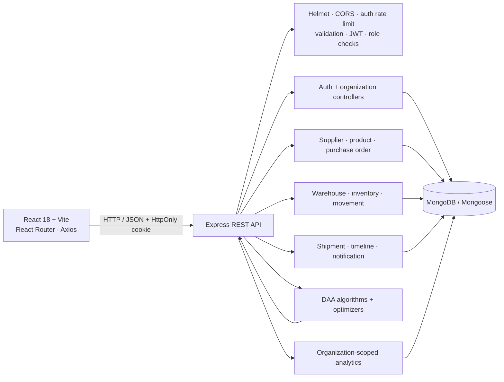
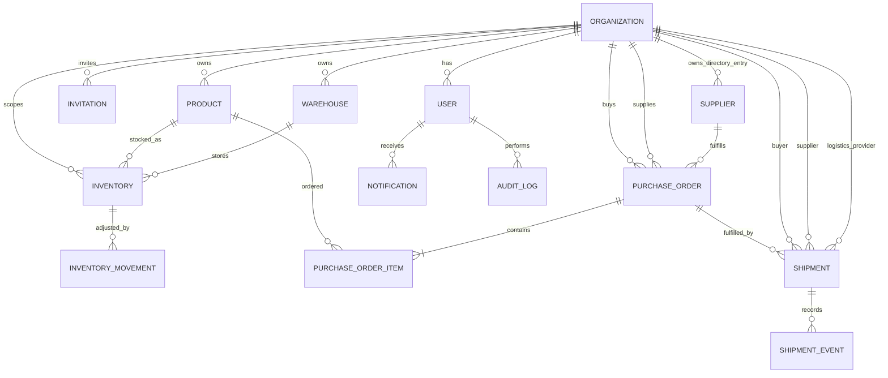

# Architecture and data model

## Component architecture

## Entity relationship diagram

Purchase-order items, shipment timelines, and transitions are embedded in their parent document so each state change can be applied atomically to that record. Inventory balance is a dedicated organization/product/warehouse document with a unique compound index; retained movement records are actor-attributed and track pending/applied/failed recovery status.

## Trust boundaries and consistency

- The API derives organization scope from the verified JWT's current database user, not a caller-supplied organization ID.
- Organization administrators and manufacturers can invite non-administrator teammates. Invitation links are single-use, expire after seven days, and store only a hash of the token. Members are disabled rather than deleted, preserving historical actor references; disabled accounts cannot authenticate.
- Supplier and logistics organizations are linked as explicit partners. Purchase-order and shipment reads require participation.
- Authentication tokens are signed using a configured secret, expire after eight hours, and are stored in HttpOnly cookies. Role checks are enforced at API handlers.
- Stock balance changes use an atomic MongoDB update; outbound changes also use a `quantity >= requested quantity` predicate. Replica-set deployments use a multi-document transaction for the balance and movement writes.
- Purchase-order and shipment transitions compare the prior status in the update filter to detect races.
- The default standalone MongoDB local configuration does not support multi-document transactions. Its alternative writes a pending movement first, then applies the balance update atomically with that movement's ID. A crash before the balance update is replayed; a crash after the update is detected by the ID marker so it is not double-applied. Run `npm run inventory:reconcile --workspace server` after an interrupted process.
- The journal protects recovery from process interruption, but this prototype is not a financial ledger; production deployment should use a replica set, reconciliation monitoring, and an independently reviewed audit policy.
- Analytics are database aggregations and explicitly identify the source. The route optimizer uses a tiny documented demonstration graph, not an external map service.

## Runtime shape

The `client` Vite development server proxies `/api` to Express. In production, serve the built client and expose the API from an HTTPS deployment with a matching `CLIENT_ORIGIN`, production cookie settings, private `JWT_SECRET`, and MongoDB connection string.
